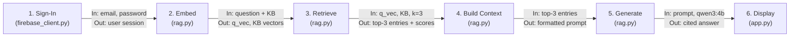

#  Sign-In Travel Assistant with RAG Chat (Lumen Travel)

**University of Science, VNU-HCM — Faculty of Information Technology**  
**Course:** Computational Thinking — Practice 03  

---

## 1. Student Information & Chosen City

- **Student Name:** Lưu Minh Tiến *(Update Student ID here if required, e.g., `25xxxxxx`)*
- **GitHub Account:** [TienLuu2007](https://github.com/TienLuu2007)
- **Chosen City:** **Ho Chi Minh City, Vietnam** (`knowledge_base.json` contains 15 curated entries `G01`–`G15` covering museums, markets, landmarks, viewpoints, parks, pagodas, walking streets, river transport, airport buses, and seasonal tips).

---

## 2. Project Structure

```text
SIGN-IN-TRAVEL-ASSISTANT-WITH-RAG-CHAT/
├── app.py                  # Streamlit UI (Firebase Auth screen + RAG Chat view)
├── firebase_client.py      # Firebase Authentication REST API client (sign-up & sign-in)
├── rag.py                  # RAG pipeline (embeddinggemma, cosine similarity, qwen3:4b)
├── knowledge_base.json     # 15 travel guide entries (G01–G15) for Ho Chi Minh City
├── requirements.txt        # Python package dependencies
├── .env.example            # Template for environment variables (empty values)
├── .gitignore              # Ensures .env and cache files are never committed
└── README.md               # Documentation, CT analysis, and test table
```

---

## 3. Setup & Running Instructions

### Step 1: Clone the Repository & Install Dependencies

```bash
git clone https://github.com/TienLuu2007/SIGN-IN-TRAVEL-ASSISTANT-WITH-RAG-CHAT.git
cd SIGN-IN-TRAVEL-ASSISTANT-WITH-RAG-CHAT

# (Optional) Create and activate a virtual environment
python -m venv .venv
# Windows PowerShell:
.\.venv\Scripts\Activate.ps1

# Install dependencies
pip install -r requirements.txt
```

### Step 2: Configure `.env`

Copy `.env.example` to `.env` and fill in your credentials (never commit `.env`):

```bash
cp .env.example .env
```

Edit `.env`:

```env
FIREBASE_API_KEY=your_firebase_web_api_key_here
OLLAMA_URL=https://your-tunnel-url.a.free.pinggy.link
```

- Make sure your Ollama server (from Lab 4) has both required models pulled:
  ```bash
  ollama pull embeddinggemma
  ollama pull qwen3:4b
  ```

### Step 3: Run the Streamlit Application

```bash
streamlit run app.py
```

---

## 4. Test Table

Below is the evaluation across **8 test questions** (3 directly answerable, 1 paraphrase, 2 not in the guide, plus 2 edge cases demonstrating **Missing Data** and **Retrieval** limitations):

| # | Type | Question | Expected Entry ID | Retrieved Top-3 IDs | Assistant Answer Summary | Correct? | Where It Failed (if wrong) |
| :-: | :--- | :--- | :---: | :---: | :--- | :-: | :--- |
| **1** | **Answerable (1)** | *"What are the opening hours and ticket prices for Independence Palace?"* | `[G01]` | `[G01]`, `[G02]`, `[G09]` | Open daily 8:00 AM – 3:30 PM; tickets cost 40,000 VND for adults and 20,000 VND for students `[G01]`. | ✅ Yes | *None (Succeeded)* |
| **2** | **Answerable (2)** | *"How can I get from Tan Son Nhat Airport to District 1 by public bus?"* | `[G11]` | `[G11]`, `[G10]`, `[G01]` | Take yellow public Bus 152 (5,000 VND, 5:30 AM – 7:00 PM) or Bus 109 (15,000 VND, 5:45 AM – 11:40 PM) `[G11]`. | ✅ Yes | *None (Succeeded)* |
| **3** | **Answerable (3)** | *"When do the street food stalls at Ho Thi Ky Flower Market open and how much do dishes cost?"* | `[G07]` | `[G07]`, `[G03]`, `[G06]` | Flower stalls open 24h; street food vendors run 3:00 PM – 11:00 PM with dishes from 25,000 to 60,000 VND `[G07]`. | ✅ Yes | *None (Succeeded)* |
| **4** | **Paraphrase** | *"How much does it cost to take a boat ride along the river from Bach Dang, and when do the boats run?"* | `[G10]` | `[G10]`, `[G05]`, `[G13]` | A one-way ticket on the Saigon Waterbus is 15,000 VND per passenger, operating between 7:00 AM and 9:00 PM `[G10]`. | ✅ Yes | *None (Succeeded)* |
| **5** | **Not in Guide (1)** | *"What is the ticket price for Dam Sen Water Park?"* | *None* (`"I don't know"`) | `[G08]`, `[G10]`, `[G05]` | `"I don't know based on the travel guide."` | ✅ Yes | *None (Correctly abstained)* |
| **6** | **Not in Guide (2)** | *"Which beach resort in Ho Chi Minh City has the best surfing lessons?"* | *None* (`"I don't know"`) | `[G12]`, `[G10]`, `[G08]` | `"I don't know based on the travel guide."` | ✅ Yes | *None (Correctly abstained)* |
| **7** | **Failure Analysis (Missing Data)** | *"Can I rent an audio guide at Independence Palace, and how much is it?"* | `[G01]` *(lacks audio guide info)* | Top-3 includes `[G02]` & `[G01]` | `"I don't know based on the travel guide."` | ⚠️ Abstains (No audio guide info) | **Missing Data** (plus **Retrieval** competition): `[G01]` does not mention audio guides (*missing data*), while `[G02]` ranks high in *retrieval* due to `"audio guides can be rented for an extra 80,000 VND"`. Thanks to `temperature=0.0` and the strict prompt, `qwen3:4b` refuses to mix `[G02]` into `[G01]`. |
| **8** | **Failure Analysis (Retrieval `k=3`)** | *"Which places in the guide have free entry?"* | `[G03]`, `[G04]`, `[G13]`, `[G14]` | Only 3 of the 4 entries fit in `top-3` | Lists at most the 3 retrieved entries and omits at least one valid entry (e.g., `[G13]` free stairs or `[G03]`/`[G04]`/`[G14]`). | ❌ Incomplete | **Retrieval** (`k = 3` cap): 4 guide entries mention `"free"` (`[G03]`, `[G04]`, `[G13]`, `[G14]`), so retrieving `top-3` drops at least one relevant entry before generation. |

---

## 5. Computational Thinking Analysis

### 5.1. Abstraction
- **Assistant Input & Output:**
  - **Input:** A signed-in user's natural language question $q$ and the cached knowledge base $\mathcal{K}$.
  - **Output:** A grounded text response citing entry IDs (e.g., `[G01]`) or `"I don't know based on the travel guide."`, accompanied by the top-$k$ retrieved entries and their cosine similarity scores.
- **Fields Kept in Each Guide Entry (`knowledge_base.json`):**
  - `id` (e.g., `"G01"`): Unique identifier required for explicit citation in the RAG response and test evaluation.
  - `title` & `text`: Core semantic content embedded by `embeddinggemma` and injected into the `qwen3:4b` prompt context.
  - `source`: Provenance of the travel information displayed in the UI.
  - `category` & `tags`: Structured metadata describing place types (e.g., `"museum"`, `"market"`, `"viewpoint"`) and attributes (`"indoor"`, `"budget"`, `"district-1"`). Ignored during decorative layout, but essential for filtering in Assignment 4 (**RAG-Rec**).

### 5.2. Decomposition



| Sub-problem | Input | Output |
| :--- | :--- | :--- |
| **1. Sign-In** | User `email` and `password` | Authenticated user object (`email`, `uid`) stored in `st.session_state.user` |
| **2. Embed** | `knowledge_base.json` (once via `@st.cache_resource`) & user `question` | 1D NumPy embedding vectors from `embeddinggemma` |
| **3. Retrieve** | Question vector `q_vec`, embedded KB, and $k=3$ | Top-3 guide entries sorted descending by cosine similarity score |
| **4. Build Context** | Top-3 retrieved dicts (`id`, `title`, `text`, `source`) | Formatted context string + strict system prompt |
| **5. Generate** | System prompt + context + user question (or threshold check) | Grounded answer from `qwen3:4b` with `[Gxx]` citations (or `"I don't know"`) |
| **6. Display** | Answer string + top-3 retrieved entries with scores | Streamlit chat bubble + expandable source panel (`st.expander`) |

### 5.3. Pattern Recognition
- **Reused from Lab 3 & Lab 4:**
  - From **Lab 3**: Firebase REST Authentication (`signInWithPassword` and `signUp`), storing login state in `st.session_state`, and gating the main application view behind authentication.
  - From **Lab 4**: Connecting to the remote Ollama server over a Pinggy tunnel (`/api/embeddings` and `/api/chat`), embedding text with `embeddinggemma`, and prompting `qwen3:4b`.
- **The `filter → score → top-k` Pattern:**
  - **Where it appears now (`retrieve_top_k` in `rag.py`):**
    1. **Filter:** Select valid candidate entries from `kb`.
    2. **Score:** Compute cosine similarity $\frac{\mathbf{q} \cdot \mathbf{e}}{\|\mathbf{q}\|\|\mathbf{e}\|}$ between the query vector and each candidate entry vector.
    3. **Top-$k$:** Sort candidates in descending order of score and slice `scored[:3]`.
  - **Where it will appear again in Assignment 4 (RAG-Rec):**
    - In **RAG-Rec**, the recommender will first **filter** places by the user's preferred `category` (e.g., `"museum"`, `"market"`) or `tags` (e.g., `"indoor"`, `"budget"`), **score** the matching places by tag overlap + embedding similarity to the user's preferences, and return the **top-$k$** recommended places.

### 5.4. Algorithm Design

#### Pseudo-code for Answering One Question
```text
ALGORITHM AnswerQuestion(question, kb, k = 3, min_score = 0.35):
    IF trim(question) is empty THEN
        DISPLAY warning "Please enter a non-empty question"
        RETURN
    END IF

    // Step 1: Embed question
    q_vec <- EmbedWithGemma(question)

    // Step 2: Filter -> Score -> Top-k
    candidates <- Filter(kb, entry has valid text)
    scored <- empty list
    FOR EACH entry IN candidates DO
        score <- Dot(q_vec, entry.embedding) / (Norm(q_vec) * Norm(entry.embedding))
        APPEND (entry, score) TO scored
    END FOR
    Sort scored descending by score
    top_k <- scored[0 : k]

    // Step 3: Two-stage "I don't know" Design Decision
    IF top_k[0].score < min_score THEN
        answer <- "I don't know based on the travel guide."
    ELSE
        context <- FormatEntriesWithIDs(top_k)
        answer <- CallQwen3_4B(system_prompt_strict, context, question)
    END IF

    // Step 4: Display & save to session state
    DisplayChat(answer, top_k)
```

#### Key Design Decision (`k = 3` and Two-Stage `"I don't know"` Rule)
- **Why $k = 3$:** With 15 concise entries in `knowledge_base.json`, retrieving $k = 3$ entries provides enough context for multi-entry or comparison questions (e.g., comparing two markets `[G03]` and `[G06]`) without overwhelming `qwen3:4b` with unrelated noise or slowing down generation over Pinggy.
- **Two-Stage `"I don't know"` Rule (Real Example):**
  - *Stage 1 (Similarity Threshold `min_score = 0.35`):* If a user asks something completely unrelated to travel (e.g., *"How do I solve a quadratic equation in Python?"*), the top cosine similarity is `< 0.35`, so the code immediately returns `"I don't know based on the travel guide."` without wasting an LLM call.
  - *Stage 2 (LLM Grounding Rule):* If a user asks *"What is the ticket price for Dam Sen Water Park?"*, the words *"ticket price"* and *"Park"* give `[G08] Saigon Zoo and Botanical Gardens` a similarity score above `0.35` (e.g., `~0.52`). Stage 2 catches this: `qwen3:4b` reads `[G08]`, `[G10]`, and `[G05]`, sees Dam Sen Water Park is not in the context, and outputs `"I don't know based on the travel guide."`

---

## 6. Known Limitations & AI Tools Used

### Known Limitations
1. **Session Persistence:** By assignment specification, chat history is stored strictly in `st.session_state` (RAM) without Firestore or an external database, so refreshing the browser tab resets the current session.
2. **Pinggy Free Tunnel Latency & Expiry:** Free Pinggy URLs expire after ~60 minutes and introduce network latency when calling `qwen3:4b` remotely. If the tunnel resets, `OLLAMA_URL` in `.env` must be updated.
3. **Small Static Knowledge Base:** The assistant only knows facts from the 15 entries (`G01`–`G15`) in `knowledge_base.json` and intentionally refuses to answer broader Ho Chi Minh City questions outside the guide.

### Note on AI Tools Used
- **AI Assistance:** Gemini (Google Antigravity) was used to help structure the Streamlit UI components, refine error handling for Firebase REST API and Ollama/Pinggy requests, and format the README documentation and Mermaid diagram. All knowledge base entries (`G01`–`G15`) and test scenarios were reviewed and verified against the assignment rubric.

---

## 7. Demonstration Video

- **Video Link:** `[Insert YouTube / Google Drive Link Here]` *(Ensure sharing permission is set to "Anyone with the link can view")*
